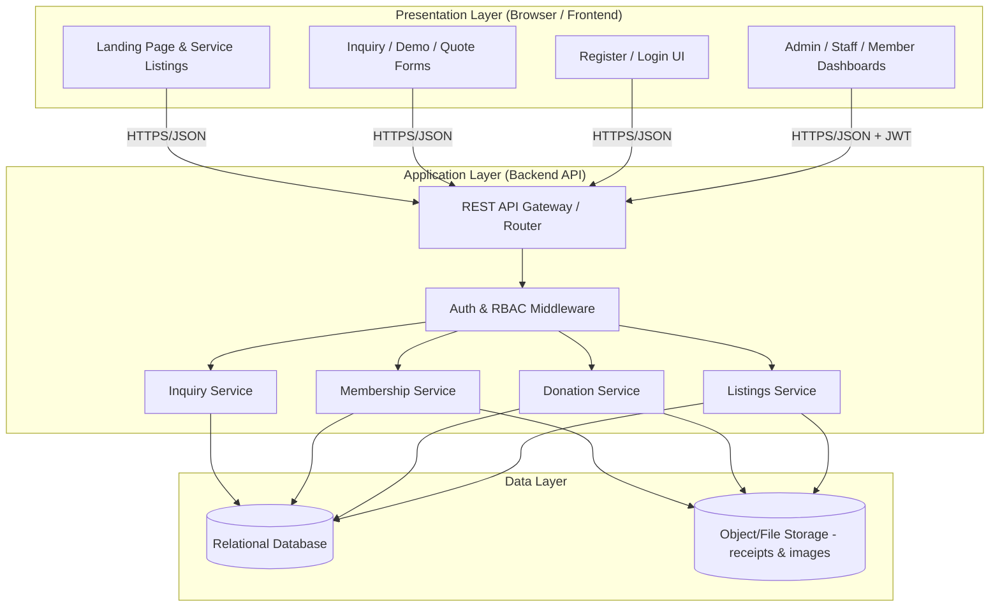
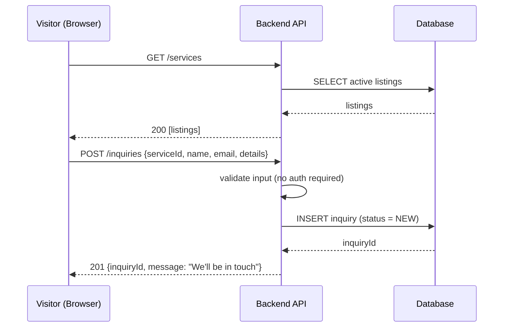
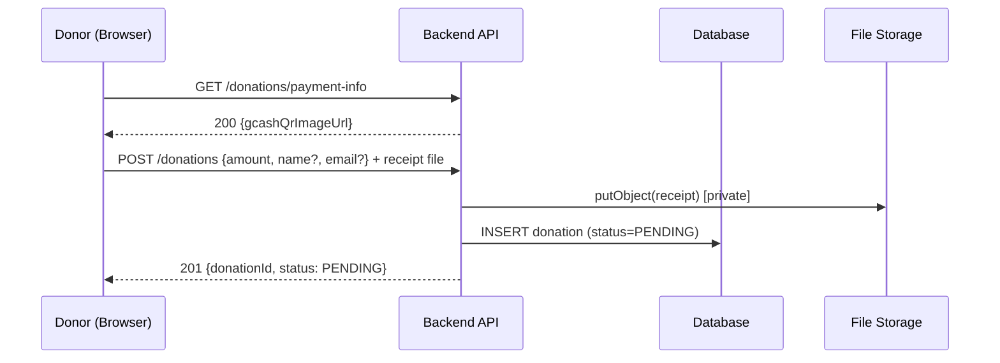
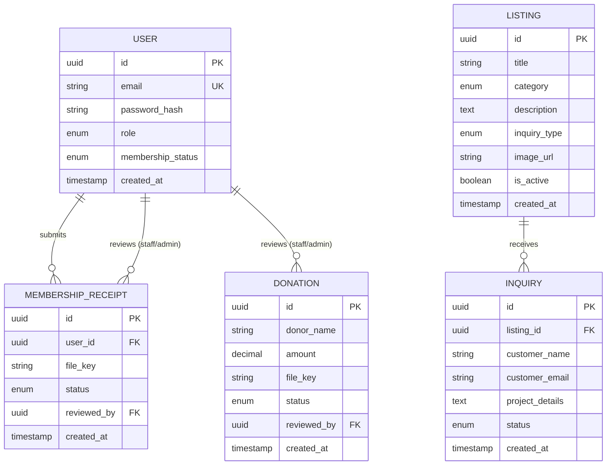
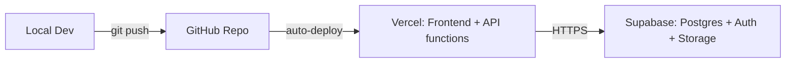

# Design Document: IT Consulting Website (Three-Tier Workshop Build)

## Overview

This document is the technical design for a fictional IT consulting and software development company website ("the platform"). It doubles as the teaching artifact for a three-part Computer Science workshop in which third-year students build, connect, and deploy a real three-tier web application using free or free-tier technologies.

The platform is a professional, business-oriented website (inspired by KwikPOS-style landing pages) where visitors can explore services, request demos/quotes, optionally become members, and make donations. Behind the public site sits an application layer that enforces authentication, role-based access control (RBAC), inquiry management, and manual verification of membership and donation receipts. A data layer persists users, listings, inquiries, receipts, and donation records, plus uploaded files.

The design deliberately favors simplicity over enterprise architecture. It is scoped so a motivated third-year student can understand every moving part: one frontend, one backend API, one database, and one file store. Where a choice adds conceptual weight without proportional learning value (for example, automated payment gateways or multi-tier subscriptions), the design omits it. The guiding constraints are: keep it free, keep it deployable, and keep it teachable.

---

## Goals and Non-Goals

**Goals**
- A publicly accessible, professional three-tier web app built on free tiers.
- Integrated service listings with per-service inquiry forms (demo/quote/inquire).
- Optional membership with GCash QR + manual receipt verification (two states only: Member, Non-Member).
- Donations with GCash QR + manual receipt verification, no account required.
- Three backend-enforced roles: Admin, Staff, User/Member.
- A curriculum that maps cleanly onto three workshop sessions.

**Non-Goals**
- Automated/real payment processing or payment gateway integration.
- Multiple membership tiers or recurring subscriptions.
- Enterprise concerns: microservices, multi-region, autoscaling clusters, CI/CD pipelines beyond a simple deploy.
- Forcing registration to browse or inquire.

---

## Architecture

The system is a classic three-tier architecture. Each tier has a single clear responsibility and communicates only with the tier directly below it.



### Three-Tier Responsibility Separation

| Tier | Responsibility | What it MUST NOT do |
|------|----------------|---------------------|
| **Presentation** | Render UI, collect input, call the API, show results. Hide UI elements based on role for UX only. | Never trust itself for security. Never talk to the database directly. |
| **Application** | Validate input, authenticate users, enforce RBAC, run business rules (e.g., "approving a receipt sets status to Member"), read/write the data layer. | No presentation logic; no direct DOM concerns. |
| **Data** | Persist and retrieve data durably; store files. | No business rules or authorization decisions. |

### How the Layers Communicate

1. **Presentation → Application:** The browser sends HTTPS requests with JSON bodies to REST endpoints. Authenticated requests carry a Supabase-issued JWT in the `Authorization` header.
2. **Application → Data:** The backend uses a database client/driver to run queries (parameterized, never string-concatenated) and a storage SDK to put/get files. File *access* always goes through the backend so permissions can be checked.
3. **Return path:** Data flows back up as JSON. Files (receipts) are never served by a public URL; the backend issues short-lived signed URLs only to authorized Admin/Staff.

The key teaching point: **the browser is untrusted**. Hiding a button in the UI is convenience, not security. The application layer re-checks every permission.

---

## Sequence Diagrams

### Flow 1: Visitor Submits a Service Inquiry (no account)



### Flow 2: Membership Registration + Receipt Verification

```mermaid
sequenceDiagram
    participant U as User (Browser)
    participant API as Backend API
    participant DB as Database
    participant FS as File Storage
    participant S as Staff/Admin

    U->>API: POST /auth/register {email, password}
    API->>DB: INSERT user (role=USER, membership=NON_MEMBER)
    API-->>U: 201 {token}
    U->>API: GET /membership/payment-info (JWT)
    API-->>U: 200 {gcashQrImageUrl}
    U->>API: POST /membership/receipt (JWT, file)
    API->>FS: putObject(receipt) [private]
    API->>DB: INSERT receipt (status=PENDING)
    API-->>U: 201 {receiptId, status: PENDING}

    S->>API: GET /admin/receipts?status=PENDING (JWT, role check)
    API->>DB: SELECT pending receipts
    API-->>S: 200 [receipts + signed view URLs]
    S->>API: POST /admin/receipts/{id}/approve (JWT, role check)
    API->>DB: UPDATE receipt=APPROVED; UPDATE user.membership=MEMBER
    API-->>S: 200 {status: APPROVED}
```

### Flow 3: Donation (anonymous allowed)



---

## Technology Stack (Finalized)

The stack is decided. There are no alternatives to weigh — this is the combination the workshop builds on.

| Layer | Technology |
|-------|------------|
| **Frontend hosting** | Vercel (static site + lightweight framework or plain HTML/CSS/JS) |
| **Backend API** | Vercel Serverless Functions (Node/JavaScript) |
| **Database** | PostgreSQL (via Supabase) |
| **File storage** | Supabase Storage (private bucket + signed URLs) |
| **Authentication** | Supabase Auth (JWT), with backend-enforced RBAC |

Supabase provides the three hard parts — database, auth, and storage — on one platform, so students manage one account, one SDK, and one set of credentials. Vercel hosts both the frontend and the API functions from the same GitHub repo with free HTTPS. Everything stays within free tiers at workshop scale, requires no credit card, and has no realistic path to surprise bills.

### What AWS Lambda Does (and why we don't use it)

AWS Lambda is a *serverless function* service: you upload a small function, AWS runs it on demand when a request arrives, then shuts it down. You never manage an always-on server and pay nothing at rest. The benefit is real, but exposing a Lambda over HTTP also requires wiring up API Gateway, IAM roles, deployment packaging, and environment config — a steep first climb for beginners.

Vercel Serverless Functions give the **same** serverless benefit (pay-nothing-at-rest, auto-scale, no server to manage) with far less wiring, because HTTP routing sits next to the frontend and auth/storage are already integrated via Supabase. So this project does not use Lambda. It's worth knowing the concept so students recognize when Lambda *would* fit: heavy, spiky, AWS-native workloads.

### Why SQL (PostgreSQL), not NoSQL

The data is highly relational: a **user** has many **membership receipts** and a membership **status**; a **service listing** has many **inquiries**; **donations** reference optional donor info and a receipt file. The admin dashboard constantly asks relational questions ("show pending receipts with the user who submitted them," "show inquiries for this service") that are natural SQL `JOIN`s. Foreign keys and constraints give us data integrity (a receipt must belong to a real user), and SQL is a core CS skill worth teaching. PostgreSQL matches the data shape, so it's the database for this project.

---

## Components and Interfaces

### Component 1: Listings Service

**Purpose:** Manage and serve service/product listings and their associated inquiry form configuration.

**Interface:**
```pascal
INTERFACE ListingsService
  FUNCTION getActiveListings(): List<Listing>
  FUNCTION getListingById(id): Listing OR NotFound
  FUNCTION createListing(adminCtx, data): Listing        // Admin only
  FUNCTION updateListing(adminCtx, id, data): Listing     // Admin only
  FUNCTION deactivateListing(adminCtx, id): Ok OR Error   // Admin only
END INTERFACE
```

**Responsibilities:**
- Return only active listings to the public.
- Restrict create/update/deactivate to Admin.

### Component 2: Inquiry Service

**Purpose:** Accept service inquiries from anyone; let Staff/Admin manage them.

**Interface:**
```pascal
INTERFACE InquiryService
  FUNCTION submitInquiry(data): Inquiry                   // Public, no auth
  FUNCTION listInquiries(staffCtx, filter): List<Inquiry> // Staff/Admin
  FUNCTION updateInquiryStatus(staffCtx, id, status): Inquiry // Staff/Admin
END INTERFACE
```

**Responsibilities:**
- Validate inquiry payloads and link each to a valid, active service.
- Default new inquiries to status `NEW`.

### Component 3: Membership Service

**Purpose:** Handle optional registration, receipt upload, and manual verification.

**Interface:**
```pascal
INTERFACE MembershipService
  FUNCTION getPaymentInfo(): PaymentInfo                       // GCash QR
  FUNCTION submitReceipt(userCtx, file): Receipt               // Member-candidate
  FUNCTION getMyMembership(userCtx): MembershipStatus          // User
  FUNCTION listPendingReceipts(staffCtx): List<Receipt>        // Staff/Admin
  FUNCTION approveReceipt(staffCtx, receiptId): Ok             // Staff/Admin
  FUNCTION rejectReceipt(staffCtx, receiptId, reason): Ok      // Staff/Admin
END INTERFACE
```

**Responsibilities:**
- Store receipts privately; never expose them publicly.
- On approval, set the user's membership state to `MEMBER` (the only transition that grants membership).

### Component 4: Donation Service

**Purpose:** Accept donations (optionally anonymous) with receipts; let Staff/Admin verify and record them.

**Interface:**
```pascal
INTERFACE DonationService
  FUNCTION getPaymentInfo(): PaymentInfo                       // GCash QR
  FUNCTION submitDonation(data, file): Donation                // Public, no auth
  FUNCTION listDonations(staffCtx, filter): List<Donation>     // Staff/Admin
  FUNCTION verifyDonation(staffCtx, donationId): Ok            // Staff/Admin
  FUNCTION rejectDonation(staffCtx, donationId, reason): Ok    // Staff/Admin
END INTERFACE
```

### Component 5: Auth & RBAC Middleware

**Purpose:** Authenticate every request and enforce role permissions on the backend.

**Interface:**
```pascal
INTERFACE AuthMiddleware
  FUNCTION authenticate(request): AuthContext OR Unauthorized
  FUNCTION requireRole(ctx, allowedRoles): Ok OR Forbidden
END INTERFACE
```

---

## Data Models

### Model: User
```pascal
STRUCTURE User
  id: UUID
  email: String                  // unique
  password_hash: Hash            // managed by Supabase Auth
  role: Enum { ADMIN, STAFF, USER }   // default USER
  membership_status: Enum { MEMBER, NON_MEMBER }  // default NON_MEMBER
  created_at: Timestamp
END STRUCTURE
```
**Validation Rules:** email unique and well-formed; role defaults to USER; membership defaults to NON_MEMBER; only receipt approval may set membership to MEMBER.

### Model: Listing
```pascal
STRUCTURE Listing
  id: UUID
  title: String
  category: Enum { CONSULTING, WEB_DEV, CUSTOM_SOFTWARE }
  description: Text
  inquiry_type: Enum { DEMO, QUOTE, INQUIRE }   // drives the form shown
  image_url: String OR NULL
  is_active: Boolean             // default true
  created_at: Timestamp
END STRUCTURE
```

### Model: Inquiry
```pascal
STRUCTURE Inquiry
  id: UUID
  listing_id: UUID               // FK -> Listing.id
  customer_name: String
  customer_email: String
  customer_phone: String OR NULL
  project_details: Text
  status: Enum { NEW, IN_PROGRESS, CLOSED }   // default NEW
  created_at: Timestamp
END STRUCTURE
```
**Validation Rules:** listing_id must reference an active listing; name/email/details required; status transitions managed by Staff/Admin.

### Model: MembershipReceipt
```pascal
STRUCTURE MembershipReceipt
  id: UUID
  user_id: UUID                  // FK -> User.id
  file_key: String               // private storage key, NOT a public URL
  status: Enum { PENDING, APPROVED, REJECTED }  // default PENDING
  reviewed_by: UUID OR NULL      // FK -> User.id (Staff/Admin)
  review_note: Text OR NULL
  created_at: Timestamp
END STRUCTURE
```

### Model: Donation
```pascal
STRUCTURE Donation
  id: UUID
  donor_name: String OR NULL     // optional (anonymous allowed)
  donor_email: String OR NULL
  amount: Decimal                // must be > 0
  file_key: String               // private receipt key
  status: Enum { PENDING, VERIFIED, REJECTED }  // default PENDING
  reviewed_by: UUID OR NULL      // FK -> User.id
  created_at: Timestamp
END STRUCTURE
```

### Database Schema & Relationships



**Relationship summary:**
- `User 1—* MembershipReceipt` (a user submits many receipts over time; only latest approval matters).
- `Listing 1—* Inquiry` (each inquiry belongs to exactly one listing).
- `Donation` optionally references a reviewing `User`; donor itself is not a user (anonymous allowed).
- Files live in storage; the DB stores only the **private key**, never a public link.

---

## Algorithmic Pseudocode

### Algorithm: Authenticate + Enforce Role (the heart of backend RBAC)

```pascal
ALGORITHM requireRole(request, allowedRoles)
INPUT: request (with Authorization header), allowedRoles (set of roles)
OUTPUT: AuthContext OR error response

BEGIN
  token ← extractBearerToken(request)
  IF token = NULL THEN
    RETURN Response(401, "Unauthorized")
  END IF

  claims ← verifyToken(token, SECRET_OR_PUBLIC_KEY)   // signature + expiry check
  IF claims = INVALID THEN
    RETURN Response(401, "Unauthorized")
  END IF

  user ← database.findUserById(claims.userId)
  IF user = NULL THEN
    RETURN Response(401, "Unauthorized")
  END IF

  // CRITICAL: role comes from the trusted DB record, not from the client
  IF user.role NOT IN allowedRoles THEN
    RETURN Response(403, "Forbidden")
  END IF

  RETURN AuthContext(userId := user.id, role := user.role)
END
```
**Preconditions:** request exists; token verification keys configured.
**Postconditions:** returns a context only if the token is valid AND the user's DB role is permitted; otherwise 401/403. No data mutation.
**Loop Invariants:** N/A.

### Algorithm: Approve Membership Receipt (grants membership)

```pascal
ALGORITHM approveReceipt(staffCtx, receiptId)
INPUT: staffCtx (role STAFF or ADMIN), receiptId
OUTPUT: Ok OR error

BEGIN
  ASSERT staffCtx.role IN { STAFF, ADMIN }   // enforced by requireRole upstream

  receipt ← database.findReceiptById(receiptId)
  IF receipt = NULL THEN
    RETURN Response(404, "Receipt not found")
  END IF

  IF receipt.status ≠ PENDING THEN
    RETURN Response(409, "Receipt already reviewed")
  END IF

  BEGIN TRANSACTION
    receipt.status ← APPROVED
    receipt.reviewed_by ← staffCtx.userId
    database.save(receipt)

    user ← database.findUserById(receipt.user_id)
    user.membership_status ← MEMBER        // the ONLY place this is set
    database.save(user)
  COMMIT TRANSACTION

  RETURN Response(200, { status: APPROVED })
END
```
**Preconditions:** caller is Staff/Admin; receipt exists and is PENDING.
**Postconditions:** receipt is APPROVED and the owning user's membership becomes MEMBER, atomically; a non-pending receipt is rejected with 409.
**Loop Invariants:** N/A.

### Algorithm: Submit Inquiry (public, no auth)

```pascal
ALGORITHM submitInquiry(data)
INPUT: data { listingId, customerName, customerEmail, projectDetails, phone? }
OUTPUT: Inquiry OR error

BEGIN
  IF NOT isNonEmpty(data.customerName)
     OR NOT isValidEmail(data.customerEmail)
     OR NOT isNonEmpty(data.projectDetails) THEN
    RETURN Response(400, "Missing or invalid fields")
  END IF

  listing ← database.findListingById(data.listingId)
  IF listing = NULL OR listing.is_active = FALSE THEN
    RETURN Response(400, "Invalid service selected")
  END IF

  inquiry ← new Inquiry(
     listing_id := listing.id,
     customer_name := sanitize(data.customerName),
     customer_email := data.customerEmail,
     project_details := sanitize(data.projectDetails),
     status := NEW
  )
  database.insert(inquiry)
  RETURN Response(201, inquiry)
END
```
**Preconditions:** none (public endpoint).
**Postconditions:** a NEW inquiry linked to an active listing is persisted, or a 400 is returned; inputs are sanitized.
**Loop Invariants:** N/A.

### Algorithm: Secure Receipt Retrieval for Review

```pascal
ALGORITHM getReceiptViewUrl(staffCtx, receiptId)
INPUT: staffCtx (STAFF or ADMIN), receiptId
OUTPUT: signedUrl OR error

BEGIN
  ASSERT staffCtx.role IN { STAFF, ADMIN }

  receipt ← database.findReceiptById(receiptId)
  IF receipt = NULL THEN
    RETURN Response(404, "Not found")
  END IF

  // Never store or return a permanent public URL. Mint a short-lived one.
  signedUrl ← storage.createSignedUrl(receipt.file_key, expiresInSeconds := 300)
  RETURN Response(200, { url := signedUrl })
END
```
**Preconditions:** caller is Staff/Admin; receipt exists.
**Postconditions:** returns a URL valid for ~5 minutes; no permanent public exposure.
**Loop Invariants:** N/A.

---

## Key Functions with Formal Specifications

### Function: submitDonation()
```pascal
FUNCTION submitDonation(data, file): Donation
```
**Preconditions:** `data.amount > 0`; `file` is a non-empty image/pdf under the size limit.
**Postconditions:** receipt file stored privately (key recorded); donation persisted with status PENDING; donor fields may be null (anonymous allowed).
**Loop Invariants:** N/A.

### Function: registerUser()
```pascal
FUNCTION registerUser(email, password): User
```
**Preconditions:** email well-formed and not already registered; password meets minimum strength.
**Postconditions:** new user created with role USER and membership NON_MEMBER; password never stored in plaintext.
**Loop Invariants:** N/A.

### Function: listPendingReceipts()
```pascal
FUNCTION listPendingReceipts(staffCtx): List<Receipt>
```
**Preconditions:** caller role in {STAFF, ADMIN}.
**Postconditions:** returns only receipts with status PENDING; each paired with a short-lived signed view URL; ordered by created_at.
**Loop Invariants:** every element returned satisfies `status = PENDING`.

---

## Example Usage

```pascal
// Example 1: Public visitor inquiring about a service (no login)
SEQUENCE
  listings ← GET "/services"
  chosen   ← user picks listings[2]       // e.g., "Custom Software Development"
  form     ← renderInquiryForm(chosen.inquiry_type)   // QUOTE form
  result   ← POST "/inquiries" WITH { listingId: chosen.id, name, email, details }
  DISPLAY "Thanks! Reference #" + result.inquiryId
END SEQUENCE

// Example 2: User becomes a member
SEQUENCE
  token ← POST "/auth/register" WITH { email, password }
  info  ← GET "/membership/payment-info"           // shows GCash QR
  DISPLAY info.gcashQrImageUrl
  // user pays via GCash externally, screenshots the receipt
  POST "/membership/receipt" WITH token, receiptFile
  DISPLAY "Receipt submitted — pending verification"
END SEQUENCE

// Example 3: Staff approves a receipt (backend re-checks role)
SEQUENCE
  pending ← GET "/admin/receipts?status=PENDING" WITH staffToken
  FOR each r IN pending DO
    open(r.signedViewUrl)       // 5-min signed URL
    IF receiptLooksValid THEN
      POST "/admin/receipts/" + r.id + "/approve" WITH staffToken
    END IF
  END FOR
END SEQUENCE
```

---

## Correctness Properties

These are stated as universal properties the implementation must uphold (good candidates for tests later):

> Note: Requirement references below are placeholders to be finalized when the requirements document is derived from this design (Design-First workflow).

### Property 1: Membership is only granted by approval
∀ user u: `u.membership_status = MEMBER` ⟹ ∃ receipt r where `r.user_id = u.id` and `r.status = APPROVED`. No other code path sets MEMBER.
**Validates: Requirements 2.5**

### Property 2: Privileged endpoints always require authorization
∀ request to an admin/staff route without a valid Staff/Admin context ⟹ response ∈ {401, 403}. Public endpoints never require auth.
**Validates: Requirements 4.4**

### Property 3: Receipts are never publicly reachable
∀ receipt r: the only way to view `r.file_key` is a signed URL minted for a Staff/Admin context; no stored field is a permanent public URL.
**Validates: Requirements 5.3**

### Property 4: Inquiry integrity
∀ inquiry i: `i.listing_id` references a listing that was active at submission time.
**Validates: Requirements 1.2**

### Property 5: Review is terminal and single
∀ receipt/donation x: once `x.status ∈ {APPROVED/VERIFIED, REJECTED}`, further approve/reject attempts return 409.
**Validates: Requirements 2.6**

### Property 6: Donation amount validity
∀ donation d: `d.amount > 0`. Donations with a non-positive amount are never persisted.
**Validates: Requirements 3.2**

### Property 7: RBAC trusts the database, not the client
The role used for authorization is always read from the persisted user record, never from a client-supplied field.
**Validates: Requirements 4.4**

---

## Error Handling

| Scenario | Condition | Response | Recovery |
|----------|-----------|----------|----------|
| Unauthenticated privileged call | No/invalid token on admin route | `401 Unauthorized` | Prompt login |
| Wrong role | Valid user, insufficient role | `403 Forbidden` | Hide feature; log attempt |
| Invalid inquiry | Missing fields / inactive listing | `400 Bad Request` with field errors | Re-show form with messages |
| Double review | Receipt/donation already reviewed | `409 Conflict` | Refresh list (optimistic UI) |
| File too large / wrong type | Upload fails validation | `400` | Ask for a valid receipt image/PDF |
| Storage/DB failure | Upstream error | `500` (generic message, no internals leaked) | Retry; log server-side |

**Principle:** error responses to the client are generic; detailed diagnostics are logged server-side only (never leak stack traces or secrets to the browser).

---

## Security Considerations

1. **Backend-enforced RBAC (non-negotiable).** Every privileged endpoint calls `requireRole` before doing work. Frontend hiding is UX only. The role is read from the DB user record, not from the token payload alone where tampering could matter — verify token signature, then load the user.
2. **Secure receipt storage.** Receipts (membership and donation) go into a **private** bucket. The database stores only a `file_key`. Access is via **short-lived signed URLs** issued only to Staff/Admin after a role check. No receipt is ever world-readable.
3. **Password safety.** Supabase Auth manages password hashing and storage; passwords are never handled or stored in plaintext by our code.
4. **Transport security.** HTTPS everywhere (free on Vercel/Supabase). JWTs have short expiries.
5. **Input validation & injection defense.** Validate and sanitize all inputs; use **parameterized queries** exclusively (no string-concatenated SQL). Escape/sanitize any user text rendered in dashboards (XSS defense).
6. **File upload hardening.** Enforce content-type allow-list (image/*, application/pdf), size caps, and never execute uploads.
7. **Least privilege.** API keys/service credentials live in server environment variables, never in frontend code or the repo.
8. **Abuse mitigation (lightweight).** Basic rate limiting / honeypot on public inquiry and donation endpoints to reduce spam, kept simple for the workshop.

---

## Performance Considerations

At workshop/student-traffic scale, performance is a non-issue; correctness and clarity matter more. Worth teaching, lightly:
- **Serverless cold starts** add a short delay on the first request after idle. Acceptable here; mention it so students understand latency spikes.
- **Indexes:** add DB indexes on frequent filters (`inquiry.status`, `receipt.status`, `donation.status`, `listing.is_active`) so dashboard queries stay fast.
- **Signed URL TTL:** short (≈5 min) balances security and usability.

---

## Deployment Approach



1. **Source control:** one GitHub repo (frontend + backend functions).
2. **Frontend + API:** connect the repo to Vercel; every push to `main` auto-deploys the frontend and the API functions together with a free HTTPS URL.
3. **Data/Auth/Storage:** create a Supabase project; run schema SQL/migrations; create a **private** storage bucket for receipts; configure Auth.
4. **Secrets:** store Supabase keys and JWT config as environment variables in Vercel — never in the repo.
5. **Public access:** share the Vercel URL. Optionally attach a free custom domain.
6. **Seed data:** insert sample listings and one Admin user so the dashboard is demonstrable on day one.

**Cost guardrails:** everything stays within free tiers at this scale; no credit card required for the recommended stack; no path to surprise bills under student usage.

---

## Identified Technical Challenges

1. **Teaching "the frontend is untrusted."** The single most important and least intuitive idea. Mitigation: demonstrate bypassing a hidden button with dev tools, then show the backend 403.
2. **Private file storage done right.** Beginners often make buckets public. Mitigation: private bucket + signed URLs from day one; never store public links.
3. **JWT/auth mental model.** Token issuance, verification, expiry, and loading the trusted user record. Mitigation: use managed Supabase Auth; diagram the flow.
4. **Manual verification workflow + idempotency.** Preventing double-approval and keeping membership/receipt state consistent. Mitigation: transactional approval + 409 on re-review.
5. **Scope creep.** Students may want payment automation or tiers. Mitigation: explicit non-goals; QR + manual verification is the ceiling.
6. **Serverless gotchas.** Cold starts, stateless functions, env config. Mitigation: keep functions small; explain statelessness.

---

## Three-Part Workshop Plan

A realistic curriculum mapped to the three tiers and build phases. Each session ends with something working and deployable.

### Session 1 — Presentation Layer & Project Foundations ("Build the storefront")
**Theme:** Three-tier concepts + a professional public frontend.
- Explain three-tier architecture and why the browser is untrusted.
- Set up GitHub repo and Vercel; deploy a "Hello World" to get a live HTTPS URL (students see deployment on day one).
- Build the public, business-oriented UI: landing page, About Us, service listings with Demo/Quote/Inquire buttons and forms (using mock/static data for now).
- **Outcome:** a live, professional-looking static site with inquiry forms that don't yet persist.

### Session 2 — Application & Data Layers ("Make it real")
**Theme:** Backend API + database + auth + RBAC.
- Create the Supabase project; design and run the SQL schema (users, listings, inquiries, receipts, donations).
- Build API endpoints: list services, submit inquiry (public), register/login (auth), submit receipt/donation (file upload to private storage).
- Implement `requireRole` and wire RBAC into privileged routes; demonstrate 401/403.
- Connect the Session 1 frontend to the live API so inquiries now persist.
- **Outcome:** inquiries, registrations, receipts, and donations persist to a real database with secure private file storage.

### Session 3 — Dashboards, Verification & Go Live ("Operate the business")
**Theme:** Admin/Staff/Member dashboards + verification workflows + polish + deploy.
- Build role-specific dashboards: Admin (users, listings, receipts, donations, inquiries), Staff (inquiries, receipts, donations), Member (status, account).
- Implement manual verification: view receipt via signed URL, approve → membership becomes MEMBER (transactional), reject with reason; verify/reject donations.
- Security review (RBAC, private receipts, input validation), add DB indexes, seed demo data.
- Final deploy; everyone visits each other's public URLs.
- **Outcome:** a complete, deployed, publicly accessible three-tier IT consulting website.

| Session | Tier focus | Key deliverable |
|---------|-----------|-----------------|
| 1 | Presentation | Live professional frontend + inquiry forms |
| 2 | Application + Data | Persistent API, DB schema, auth, RBAC, secure uploads |
| 3 | Full stack | Role dashboards, manual verification, final public deployment |

---

## Dependencies

- **Vercel** account (frontend + serverless API hosting).
- **Supabase** project (PostgreSQL, Auth, Storage).
- **GitHub** repository (source + auto-deploy trigger).
- A lightweight frontend built with a web framework or plain HTML/CSS/JS.
- A GCash account/QR image for membership and donation payment display (provided as static assets).
