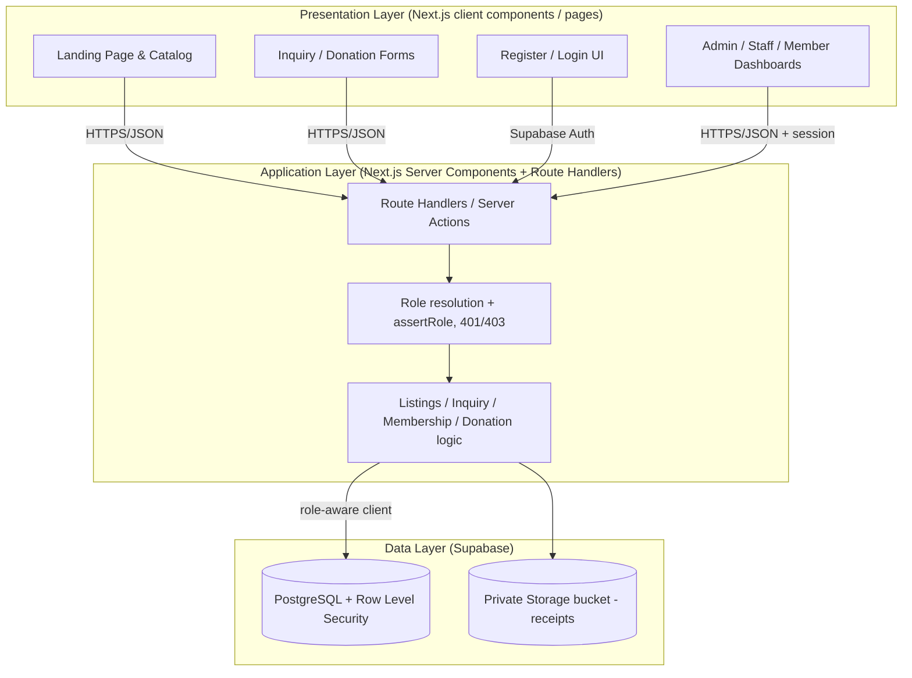
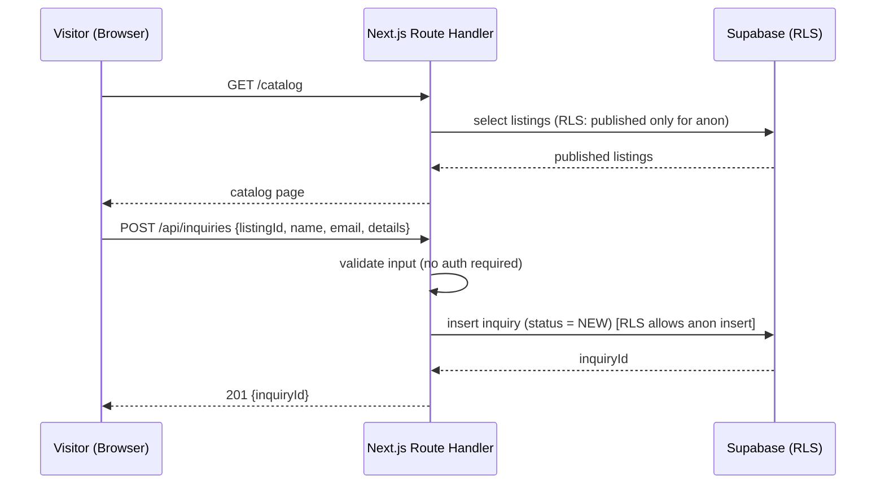
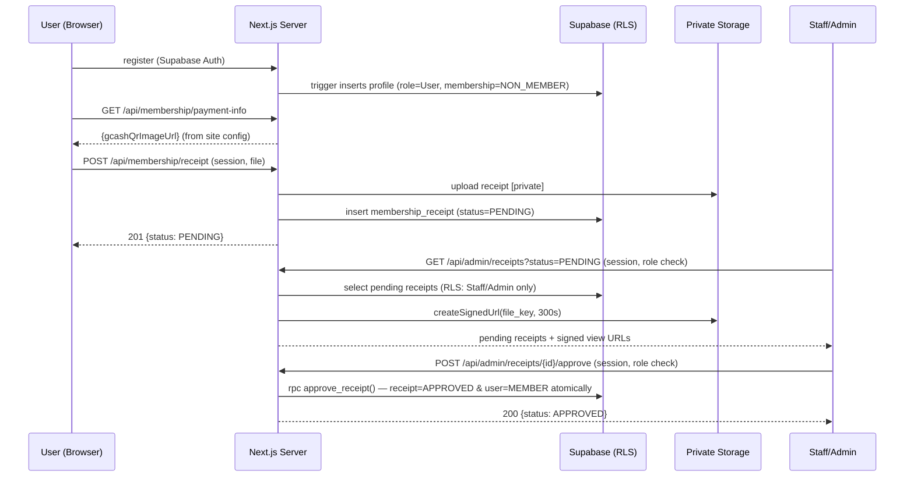
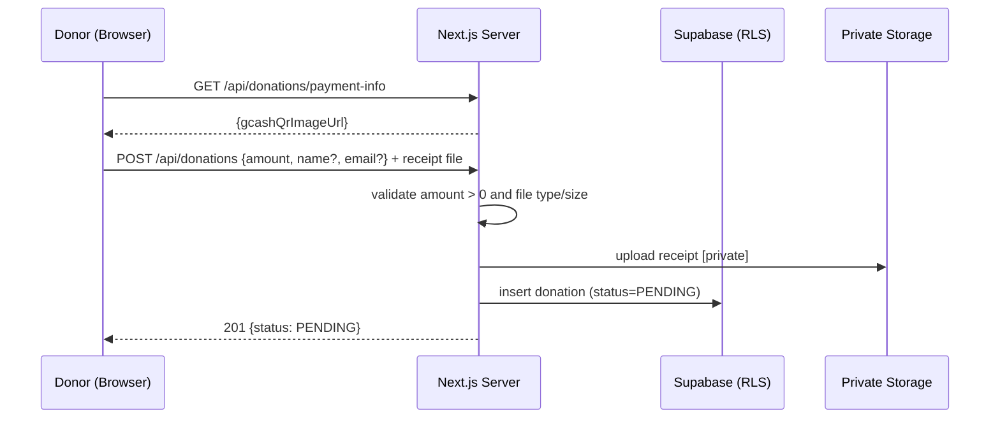
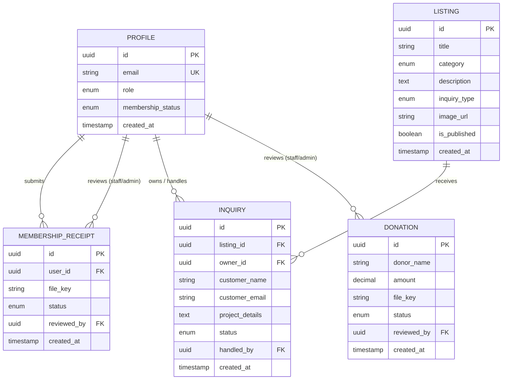
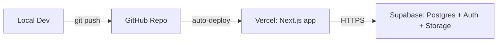

# Design Document: Three-Tier Catalog & Membership Website (Workshop Build)

## Overview

This document is the technical design for a three-tier IT consulting / product-catalog website that doubles as the teaching artifact for a three-part Computer Science workshop. It reconciles two earlier specs:

- **Version A** (`pos-catalog-site-core`): a lean **Next.js + Supabase RLS** core with a file-editing customization model.
- **Version B** (`it-consulting-website`): the fuller scope — membership with receipts, donations, and Staff/Admin review workflows.

The reconciled design keeps **A's single-framework simplicity** (one Next.js app, no hand-wired serverless tiers) and its **assemble-and-customize teaching model**, and folds in **B's richer features** (membership receipts, donations, manual verification dashboards). PostgreSQL **Row Level Security (RLS)** is the authoritative access boundary; application-layer role checks exist for 401/403 responses and UX only.

The workshop is taught in an **assemble-and-customize** style: ready-to-run code ships to students, who **provision their own accounts** (GitHub, Supabase, Vercel), apply the provided schema/RLS SQL to their own Supabase project, customize data files, paste their own keys, drop in assets, and operate finished dashboards. They do not write the hard backend code — but they own and control the infrastructure it runs on. Delivery is three sessions (three separate days, ~3 usable hours each), each ending in something visibly working.

---

## Goals and Non-Goals

**Goals**
- A publicly accessible three-tier web app on free tiers, built as a single Next.js (App Router, TypeScript) app on Vercel + Supabase.
- Public catalog with per-listing inquiry forms (demo/quote/inquire), no account required.
- Optional membership: register, upload GCash receipt, manual Staff/Admin approval → MEMBER (two states only).
- Donations (optionally anonymous) with GCash receipt + manual verification.
- Three backend-enforced roles (Admin, Staff, User) with RLS as the authoritative boundary.
- A curriculum that maps cleanly onto three assemble-and-customize sessions.

**Non-Goals**
- Automated/real payment processing or gateway integration (GCash QR + manual verification is the ceiling).
- Multiple membership tiers or subscriptions.
- Enterprise concerns: microservices, multi-region, autoscaling, complex CI/CD.
- Forcing registration to browse or inquire.
- A separate hand-wired serverless tier split (the reconciled design uses one Next.js app).
- Student-written test suites (property/unit tests are instructor-maintained and optional).

---

## Architecture

A classic three-tier architecture, delivered as **one Next.js application** plus Supabase. The "application layer" is Next.js **Server Components and Route Handlers**; the "data layer" is Supabase Postgres + Storage, with **RLS as the authoritative access boundary**.



### Three-Tier Responsibility Separation

| Tier | Responsibility | What it MUST NOT do |
|------|----------------|---------------------|
| **Presentation** (Next.js client UI) | Render UI, collect input, call route handlers/server actions, show results. Hide UI by role for UX only. | Never trust itself for security. Never talk to the database directly. |
| **Application** (Next.js server) | Validate input, resolve role from the verified session, provide 401/403, run business rules, call the role-aware Supabase client. | No presentation/DOM logic. It is NOT the final security boundary — RLS is. |
| **Data** (Supabase) | Persist/retrieve data; store files privately. **Enforce access via RLS** — the authoritative boundary. | — |

### Why RLS is the authoritative boundary

The single most important teaching point is **the browser is untrusted** — and, in this design, so is the application layer by itself. Application-layer `assertRole` gives friendly 401/403 responses and hides controls, but the final guarantee lives in the database: RLS policies decide which rows each role may read or write, using a role resolved from the verified session (`auth.uid()` → the member's `profiles.role`), never from client input. Even a bypassed frontend or a crafted request cannot read rows RLS forbids.

### How the Layers Communicate

1. **Presentation → Application:** The browser calls Next.js route handlers / server actions over HTTPS with JSON. Authenticated requests carry the Supabase session (JWT in a cookie readable by the server client).
2. **Application → Data:** The server uses a **role-aware Supabase client** (reads the session JWT) for normal access so RLS applies, and a **service-role client confined to server-only modules** for the few privileged admin operations (e.g. role assignment). File access always goes through the server so permissions are checked; receipts are fetched via short-lived signed URLs.
3. **Return path:** Data flows back as JSON/props. Receipts are never served by a public URL — only via signed URLs minted for Staff/Admin.

---

## Sequence Diagrams

### Flow 1: Visitor Submits an Inquiry (no account)



### Flow 2: Membership Registration + Receipt Verification



### Flow 3: Donation (anonymous allowed)



---

## Technology Stack (Finalized)

The stack is decided. One framework, one platform — no alternatives to weigh.

| Layer | Technology |
|-------|------------|
| **Frontend + App layer** | Next.js (App Router, TypeScript) — Server Components, Route Handlers, Server Actions |
| **Hosting** | Vercel (frontend + server runtime from one GitHub repo) |
| **Database** | PostgreSQL via Supabase, with **Row Level Security** as the authoritative boundary |
| **File storage** | Supabase Storage (private bucket + signed URLs) |
| **Authentication** | Supabase Auth (JWT in session cookie), role stored in `profiles` |

Supabase provides the three hard parts — database, auth, storage — on one platform. A single Next.js app on Vercel serves both the UI and the server logic, so students hold one mental model, one repo, and one set of credentials. Everything stays within free tiers at workshop scale. **Each student provisions their own Supabase project, GitHub repo, and Vercel project**, so they fully own their deployment and its `.env` secrets (no shared backend).

### Why SQL (PostgreSQL), not NoSQL

The data is highly relational: a **user** has many **membership receipts** and a **membership status**; a **listing** has many **inquiries**; **donations** reference optional donor info and a receipt file. Dashboards constantly ask relational questions ("pending receipts with the submitting user," "inquiries for this listing") that are natural SQL JOINs. Foreign keys and constraints give integrity, and — crucially here — **RLS is a Postgres feature**, which is what makes the data layer the authoritative security boundary.

### Why a single Next.js app (reconciliation note)

Version B split the application layer into hand-wired Vercel serverless functions grouped by domain. The reconciled design collapses that into **one Next.js app** (route handlers + server components) to reduce the number of moving parts students must understand, while preserving the exact same three-tier *responsibilities*. The domain "services" from B (Listings, Inquiry, Membership, Donation, Auth) survive as server-side modules, not as separate deployable functions.

---

## UI/UX Design System (presentation layer)

The presentation layer is built on a small, teachable design system rather than ad-hoc per-screen styling. This satisfies Requirement 15 and the `ui-ux-design` steering rules. It is a presentation concern only — RLS and the application layer remain the authoritative security boundary.

### Design tokens (single source of truth)

A central token file (CSS custom properties in a `theme.css`, or the Tailwind config) is the only place raw design values live. No component hardcodes a color, spacing, radius, or shadow outside the tokens.

| Token group | Contents |
|-------------|----------|
| **Color** | ≤2 primary/accent colors + intentional neutrals; semantic roles (bg, surface, border, text, muted, accent, and status colors for PENDING/APPROVED/REJECTED/VERIFIED). Defined for **both dark and light** with strict parity. Text/interactive pairs meet WCAG AA contrast. |
| **Typography** | A deliberate type scale with intentional line-heights and tighter tracking on headings. |
| **Spacing** | A single spacing scale used for padding/margins/gaps (no ad-hoc pixel values in components). |
| **Radius** | A unified set of border radii (one or two steps). |
| **Shadow** | Subtle, directional, or flat/border-driven depth rules — favoring 1px borders and background shifts over heavy drop shadows. |
| **Motion** | Transition tokens in the 150ms–200ms ease-out range. |

### Primitive components

A small set of reusable primitives compose every screen; new screens assemble these rather than inventing styles:

- **Button** — variants (primary/secondary/ghost) with full hover, focus-visible ring, active, and disabled states.
- **Field / Input** — label + control + inline error slot, with focus-visible and error styling.
- **Card** — token-driven surface; sizes may vary by content (not a uniform grid cell).
- **StatusBadge** — maps a record status (PENDING/APPROVED/REJECTED/NEW/IN_PROGRESS/CLOSED/VERIFIED) to a token-driven color.
- **FormRow / Feedback** — layout + success/error messaging used by inquiry, auth, receipt, and donation forms.

### Required states (every data-driven screen)

Each screen that fetches or submits data must explicitly handle the full state set, not just the happy path:

| State | Treatment |
|-------|-----------|
| **Loading** | Skeleton or spinner until data resolves. |
| **Empty** | Helpful guidance or a CTA when there is no data (e.g. an empty catalog, no pending receipts). |
| **Error** | Field-level validation feedback for forms; a clear message + recovery action for failed fetches/actions. |
| **Interactive** | Hover, focus-visible, active, disabled on every clickable element. |

### Layout principles

Mobile-first and responsive throughout. Design for real information density and ergonomic scanning (F-pattern for content, Z-pattern for action-light screens). Vary component sizing where it aids hierarchy; avoid the cookie-cutter equal-height 3-column card grid and the banned decorative tropes (mesh gradients, glassmorphism blobs, oversized hero + badge pills) unless a screen explicitly calls for them.

### Workshop fit

Because students customize copy, images, and branding (`content/*`, `public/images/*`), the tokens and primitives must absorb those changes — new text, a new brand accent, a replaced image — without breaking layout. The system stays small enough to teach in one session and robust enough to survive student edits.

---

## Components and Interfaces

Domain logic lives in server-side modules. Each maps to a Version B service but runs inside the single Next.js app.

### Component 1: Listings
```pascal
INTERFACE Listings
  FUNCTION getVisibleListings(ctx): List<Listing>   // RLS returns published, or all for Staff/Admin
  FUNCTION getListingById(ctx, id): Listing OR NotFound
  FUNCTION createListing(adminCtx, data): Listing    // Admin only (assertRole + RLS)
  FUNCTION updateListing(adminCtx, id, data): Listing // Admin only
  FUNCTION setPublished(adminCtx, id, bool): Ok       // Admin only
END INTERFACE
```

### Component 2: Inquiry
```pascal
INTERFACE Inquiry
  FUNCTION submitInquiry(data): Inquiry               // Public, no auth
  FUNCTION listInquiries(staffCtx, filter): List<Inquiry> // Staff/Admin
  FUNCTION updateInquiryStatus(staffCtx, id, status): Inquiry // Staff/Admin
  FUNCTION setHandledBy(staffCtx, id, memberId): Ok   // Staff/Admin
END INTERFACE
```

### Component 3: Membership
```pascal
INTERFACE Membership
  FUNCTION getPaymentInfo(): PaymentInfo              // GCash QR from site config
  FUNCTION submitReceipt(userCtx, file): Receipt      // authenticated User
  FUNCTION getMyMembership(userCtx): MembershipStatus
  FUNCTION listPendingReceipts(staffCtx): List<Receipt+SignedUrl> // Staff/Admin
  FUNCTION approveReceipt(staffCtx, receiptId): Ok    // Staff/Admin (transactional)
  FUNCTION rejectReceipt(staffCtx, receiptId, reason): Ok // Staff/Admin
END INTERFACE
```

### Component 4: Donation
```pascal
INTERFACE Donation
  FUNCTION getPaymentInfo(): PaymentInfo
  FUNCTION submitDonation(data, file): Donation        // Public, no auth
  FUNCTION listDonations(staffCtx, filter): List<Donation> // Staff/Admin
  FUNCTION verifyDonation(staffCtx, id): Ok            // Staff/Admin
  FUNCTION rejectDonation(staffCtx, id, reason): Ok    // Staff/Admin
END INTERFACE
```

### Component 5: Auth & Role Resolution
```pascal
INTERFACE Auth
  FUNCTION getRoleFromSession(request): Role OR Unauthenticated // verify JWT, read profiles.role
  FUNCTION assertRole(ctx, allowedRoles): Ok OR (401 | 403)     // UX layer; RLS is authoritative
END INTERFACE
```

---

## Data Models

### Model: Profile / User
```pascal
STRUCTURE Profile
  id: UUID                       // == auth.users.id
  email: String                  // unique (from Supabase Auth)
  role: Enum { ADMIN, STAFF, USER }        // default USER
  membership_status: Enum { MEMBER, NON_MEMBER } // default NON_MEMBER
  created_at: Timestamp
END STRUCTURE
```
**Rules:** a `profiles` row is created by trigger on new auth user, role defaults to USER, membership defaults to NON_MEMBER; only receipt approval sets MEMBER; role changes are Admin-only.

### Model: Listing
```pascal
STRUCTURE Listing
  id: UUID
  title: String
  category: Enum { CONSULTING, WEB_DEV, CUSTOM_SOFTWARE }
  description: Text
  inquiry_type: Enum { DEMO, QUOTE, INQUIRE }
  image_url: String              // site-relative under /images/ (file in public/)
  is_published: Boolean          // default false (unpublished)
  created_at: Timestamp
END STRUCTURE
```

### Model: Inquiry
```pascal
STRUCTURE Inquiry
  id: UUID
  listing_id: UUID               // FK -> Listing.id
  owner_id: UUID OR NULL         // FK -> Profile.id for authenticated submitters; null if anonymous
  customer_name: String
  customer_email: String
  customer_phone: String OR NULL
  project_details: Text
  status: Enum { NEW, IN_PROGRESS, CLOSED }   // default NEW
  handled_by: UUID OR NULL       // FK -> Profile.id (Staff/Admin)
  created_at: Timestamp
END STRUCTURE
```

### Model: MembershipReceipt
```pascal
STRUCTURE MembershipReceipt
  id: UUID
  user_id: UUID                  // FK -> Profile.id
  file_key: String               // private storage key, NOT a public URL
  status: Enum { PENDING, APPROVED, REJECTED }  // default PENDING
  reviewed_by: UUID OR NULL      // FK -> Profile.id (Staff/Admin)
  review_note: Text OR NULL
  created_at: Timestamp
END STRUCTURE
```

### Model: Donation
```pascal
STRUCTURE Donation
  id: UUID
  donor_name: String OR NULL     // optional (anonymous allowed)
  donor_email: String OR NULL
  amount: Decimal                // CHECK (amount > 0)
  file_key: String               // private receipt key
  status: Enum { PENDING, VERIFIED, REJECTED }  // default PENDING
  reviewed_by: UUID OR NULL      // FK -> Profile.id
  review_note: Text OR NULL
  created_at: Timestamp
END STRUCTURE
```

### Database Schema & Relationships



---

## Row Level Security (the authoritative boundary)

RLS policies use a SQL helper that resolves the caller's role from `profiles` keyed by `auth.uid()`, so the role is always derived from the verified session, never from client input.

```pascal
-- Helper
FUNCTION current_role(): role
  RETURN (SELECT role FROM profiles WHERE id = auth.uid())

-- listings
POLICY listings_read:   published rows to anon/USER; all rows to STAFF/ADMIN
POLICY listings_write:  insert/update/publish only when current_role() = ADMIN

-- inquiries
POLICY inquiry_insert:  allow anon + authenticated insert
POLICY inquiry_read:    USER reads only rows where owner_id = auth.uid(); STAFF/ADMIN read all
POLICY inquiry_update:  status/handled_by updates only when current_role() IN (STAFF, ADMIN)

-- membership_receipt
POLICY receipt_insert:  authenticated user inserts own PENDING receipt
POLICY receipt_read:    USER reads own; STAFF/ADMIN read all
POLICY receipt_review:  status updates only when current_role() IN (STAFF, ADMIN)

-- donation
POLICY donation_insert: allow anon insert (amount>0 enforced by CHECK)
POLICY donation_read:   STAFF/ADMIN read all; others none
POLICY donation_review: status updates only when current_role() IN (STAFF, ADMIN)

-- profiles
POLICY profile_read:    member reads own; ADMIN reads all
POLICY profile_role:    role changes only when current_role() = ADMIN (service-role client)
```

---

## Algorithmic Pseudocode

### Algorithm: Resolve role + assert (application-layer UX; RLS is authoritative)

```pascal
ALGORITHM assertRole(request, allowedRoles)
BEGIN
  session ← verifySupabaseSession(request)   // signature + expiry
  IF session = INVALID THEN RETURN Response(401, "Unauthorized")
  role ← db.selectRole(session.userId)       // from profiles (trusted)
  IF role NOT IN allowedRoles THEN RETURN Response(403, "Forbidden")
  RETURN Ctx(userId := session.userId, role := role)
END
```
Note: even if this check were bypassed, RLS still forbids the underlying row access.

### Algorithm: Approve Membership Receipt (grants membership, transactional)

```pascal
ALGORITHM approveReceipt(staffCtx, receiptId)  -- executed as a Postgres rpc/function
BEGIN
  ASSERT staffCtx.role IN { STAFF, ADMIN }
  receipt ← findReceiptById(receiptId)
  IF receipt = NULL THEN RETURN Response(404)
  IF receipt.status ≠ PENDING THEN RETURN Response(409, "Already reviewed")
  BEGIN TRANSACTION
    receipt.status ← APPROVED; receipt.reviewed_by ← staffCtx.userId; save(receipt)
    user ← findUserById(receipt.user_id)
    user.membership_status ← MEMBER            // the ONLY place this is set
    save(user)
  COMMIT
  RETURN Response(200, { status: APPROVED })
END
```

### Algorithm: Submit Inquiry (public)

```pascal
ALGORITHM submitInquiry(data)
BEGIN
  IF NOT isNonEmpty(data.name) OR NOT isValidEmail(data.email) OR NOT isNonEmpty(data.details)
    THEN RETURN Response(400, fieldErrors)
  listing ← findListingById(data.listingId)
  IF listing = NULL OR NOT listing.is_published THEN RETURN Response(400, "Invalid listing")
  insert Inquiry(listing_id, owner_id?, sanitize(name), email, sanitize(details), status := NEW)
  RETURN Response(201, inquiry)
END
```

### Algorithm: Secure Receipt View URL

```pascal
ALGORITHM getReceiptViewUrl(staffCtx, receiptId)
BEGIN
  ASSERT staffCtx.role IN { STAFF, ADMIN }
  receipt ← findReceiptById(receiptId)
  IF receipt = NULL THEN RETURN Response(404)
  signedUrl ← storage.createSignedUrl(receipt.file_key, expiresInSeconds := 300)
  RETURN Response(200, { url := signedUrl })
END
```

---

## Correctness Properties

> These validate the reconciled requirements. They are instructor-maintained and optional (off the student critical path).

### Property 1: Membership is only granted by approval
`membership_status = MEMBER` ⟹ an APPROVED receipt exists for that user; no other path sets MEMBER (receipt→APPROVED and user→MEMBER happen atomically).
**Validates: Requirements 8.3, 8.4**

### Property 2: Privileged access is always authorized
Any Staff/Admin action without a valid Staff/Admin context returns 401/403, and RLS denies the underlying row access regardless of the app-layer check.
**Validates: Requirements 6, 7, 12.5, 14.1, 14.2**

### Property 3: Receipts are never publicly reachable
A receipt `file_key` is viewable only via a Staff/Admin-minted signed URL; no stored field is a permanent public URL.
**Validates: Requirements 10**

### Property 4: Inquiry integrity
Every persisted inquiry references a listing that was published/active at submission time.
**Validates: Requirements 4.3**

### Property 5: Review is terminal and single
Once a receipt/donation is reviewed, further approve/reject/verify attempts return 409.
**Validates: Requirements 8.6, 9.9**

### Property 6: Donation amount validity
Donations persist only when `amount > 0`.
**Validates: Requirements 9.2**

### Property 7: RBAC trusts the database, not the client
The authorization role is always read from the persisted `profiles` record, and RLS is the authoritative boundary.
**Validates: Requirements 6.1, 7**

---

## Testing Strategy

Automated tests are **instructor-maintained and optional** — they are off the student critical path (students assemble and operate, they do not write tests). When the repo author does add tests, they target the correctness properties and error paths above.

- **Property-based tests** (e.g. Vitest + fast-check) for the seven correctness properties: membership-only-by-approval, privileged-access-authorization, receipts-never-public, inquiry integrity, terminal-and-single review, donation amount validity, and DB-trusted RBAC.
- **Unit tests** for validation and error paths: 401 vs 403 resolution, inquiry field-level 400s, inactive/nonexistent listing rejection, file type/size rejection, and 409 on re-reviewing a non-PENDING record.
- **RLS tests** that confirm the database denies forbidden rows even when the application-layer `assertRole` check is bypassed — the key demonstration that RLS, not the app layer, is the authoritative boundary.
- **Manual workshop verification** per session via the checkpoints in `tasks.md`: Session 1 (catalog + forms render, site deploys), Session 2 (registration, receipt/donation persist as PENDING), Session 3 (approve → MEMBER, 403 + RLS denial demonstrated).

---

## Error Handling

| Scenario | Condition | Response | Recovery |
|----------|-----------|----------|----------|
| Unauthenticated privileged call | No/invalid session on admin route | `401` | Prompt login |
| Wrong role | Valid user, insufficient role | `403` | Hide feature; RLS also denies |
| Invalid inquiry | Missing fields / unpublished listing | `400` + field errors | Re-show form |
| Double review | Receipt/donation already reviewed | `409` | Refresh list |
| File too large / wrong type | Upload fails validation | `400` | Ask for a valid receipt |
| Storage/DB failure | Upstream error | `500` (generic) | Retry; log server-side |

**Principle:** client errors are generic; detailed diagnostics are logged server-side only.

---

## Security Considerations

1. **RLS is the authoritative boundary.** Application `assertRole` provides 401/403 and hides controls, but the database decides access. Role is resolved from `profiles` via `auth.uid()`, never from client input.
2. **Secure receipt storage.** Receipts go into a **private** bucket; the DB stores only a `file_key`. Access is via short-lived (~300s) signed URLs issued only to Staff/Admin.
3. **Password safety.** Supabase Auth manages hashing; no plaintext passwords in our code.
4. **Secrets.** Only the Supabase **anon key + URL** are exposed via `NEXT_PUBLIC_`. The **service_role** key is server-only (used for the few privileged admin writes like role assignment) and never shipped to the browser.
5. **Transport security.** HTTPS everywhere (free on Vercel/Supabase).
6. **Input validation & injection defense.** Validate/sanitize all inputs; use the Supabase query builder / parameterized SQL; escape user text rendered in dashboards (XSS).
7. **File upload hardening.** Content-type allow-list (image/*, application/pdf) + size caps.

---

## Performance Considerations

At workshop scale, correctness and clarity matter more than performance. Worth teaching lightly:
- Serverless/edge cold starts add a short first-request delay; acceptable.
- Add DB indexes on frequent filters: `inquiry.status`, `membership_receipt.status`, `donation.status`, `listing.is_published`.
- Signed URL TTL (~5 min) balances security and usability.

---

## Deployment Approach



Each student provisions their **own** stack (no shared backend):

1. **Source control:** each student **forks** the provided repo into their own GitHub account (the Next.js app).
2. **Hosting:** each student connects *their* fork to *their own* Vercel project; pushes to `main` auto-deploy with free HTTPS.
3. **Data/Auth/Storage:** each student creates *their own* Supabase project, runs the provided schema + RLS + approval-function SQL, creates *their own* **private** receipts bucket, and runs the provided seed script to insert listings + their own Admin/Staff/User accounts.
4. **Secrets (student-owned):** each student sets `NEXT_PUBLIC_SUPABASE_URL` and `NEXT_PUBLIC_SUPABASE_ANON_KEY` (public) and `SUPABASE_SERVICE_ROLE_KEY` (server-only) in their own `.env` and their own Vercel project settings — never committed to the repo.
5. **Connect:** students paste *their own* keys (the "paste the endpoint" pattern, but with keys from their own project).

**Cost guardrails:** everything stays within free tiers; no credit card; no surprise bills. Each student's project is independent, so one student's mistake never affects another's.

---

## Identified Technical Challenges

1. **Teaching "the frontend is untrusted" — and that RLS, not the app layer, is authoritative.** Mitigation: demonstrate bypassing a hidden control, show the 403, then show RLS still denying the row.
2. **Private file storage done right.** Mitigation: private bucket + signed URLs from day one; never store public links.
3. **Auth/session mental model.** Mitigation: managed Supabase Auth; diagram the session→`profiles.role` flow.
4. **Manual verification + idempotency.** Mitigation: transactional approval via a Postgres function; 409 on re-review.
5. **Scope creep.** Mitigation: explicit non-goals; QR + manual verification is the ceiling.
6. **Per-student setup friction (the main clock risk).** Each student provisions their own GitHub fork, Supabase project, private bucket, and Vercel project, and sets their own `.env` — real ownership, but the biggest time cost in the workshop. Mitigation: ship a single copy-paste SQL script (schema + RLS + approval function + seed) and a short, screenshot-backed setup checklist; do account creation (GitHub/Supabase/Vercel sign-ups) as a **prerequisite before Session 1** so class time is spent applying scripts and pasting keys, not waiting on sign-up emails.

---

## Three-Part Workshop Plan (assemble-and-customize)

Each session is ~3 usable hours (12:30–4:00 with breaks), on three separate days, and ends with something visibly working. Students customize files, paste keys, and operate finished features rather than writing backend code.

### Session 1 — Build the storefront (Presentation)
**Theme:** three-tier concepts + a personalized public site.
- Explain the three tiers and why the browser (and app layer alone) is untrusted; RLS is authoritative.
- Students get the running Next.js app and deploy it to Vercel (live HTTPS URL on day one).
- **Customize:** edit the landing/branding content file; edit the `listings` data/seed and drop images into `public/images/`; see the catalog and per-type inquiry forms render.
- **Outcome:** a live, personalized catalog with inquiry forms (which begin persisting once the student connects their own backend in Session 2).

### Session 2 — Make it real (Application + Data + payment/membership)
**Theme:** provision your own backend; enable accounts, membership, and donations.
- **Provision:** each student creates their own Supabase project, runs the provided schema + RLS + approval-function SQL, creates a private receipts bucket, and runs the seed script (listings + their own Admin/Staff/User accounts).
- **Paste your own keys:** students set their own `NEXT_PUBLIC_SUPABASE_URL`, `NEXT_PUBLIC_SUPABASE_ANON_KEY`, and server-only `SUPABASE_SERVICE_ROLE_KEY` in `.env` and in their own Vercel project.
- **Customize:** drop in their GCash QR image + payment label/config; edit membership copy/benefits text.
- Walk through auth (register/login/logout), the `profiles` role model, and how RLS decides access.
- Enable the pre-built membership receipt upload and donation flows; submit a test receipt/donation and watch it persist as PENDING.
- **Outcome:** real registration, receipt upload, and donations persisting to the student's **own** Supabase backend with private storage.

### Session 3 — Operate the business (Dashboards + go live)
**Theme:** run the finished dashboards and deploy the final site.
- Log in as the seeded **Admin/Staff** and use the finished dashboards: triage inquiries; review pending receipts via signed URLs; approve → membership becomes MEMBER (transactional); reject with reason; verify/reject donations; manage listings; assign roles.
- Demonstrate the security story live: bypass a hidden control, get a 403, and show RLS denying the row.
- Final deploy; everyone visits each other's public URLs.
- **Outcome:** a complete, deployed, publicly accessible three-tier site the student can actually operate.

| Session | Tier focus | Student action | Key deliverable |
|---------|-----------|----------------|-----------------|
| 1 | Presentation | Fork repo, edit content/listings, drop images, deploy to own Vercel | Live personalized catalog + inquiry forms |
| 2 | Application + Data | Create own Supabase, run SQL, set own keys, drop GCash QR, enable flows | Persistent accounts, receipts, donations (own backend) |
| 3 | Full stack | Seed own roles, operate dashboards, verify, deploy | Operable, deployed three-tier site they fully own |

---

## Dependencies

Each student provisions and owns all of the following (no shared resources):

- **GitHub** account + a **fork** of the provided repo (source + auto-deploy trigger).
- **Vercel** account + their own project (hosts the Next.js app) with their own env vars.
- **Supabase** project — **student-provisioned** (PostgreSQL + RLS, Auth, private Storage bucket), set up by running the provided schema/RLS/approval SQL and seed script.
- A **GCash QR image** per student/site (dropped into `public/` as a static asset) for membership and donation payment display.

**Prerequisite (before Session 1):** students create their GitHub, Supabase, and Vercel accounts and install Node + a code editor, so class time is spent applying scripts and customizing rather than waiting on account sign-ups (mirrors the original workshop's Prerequisites section).
